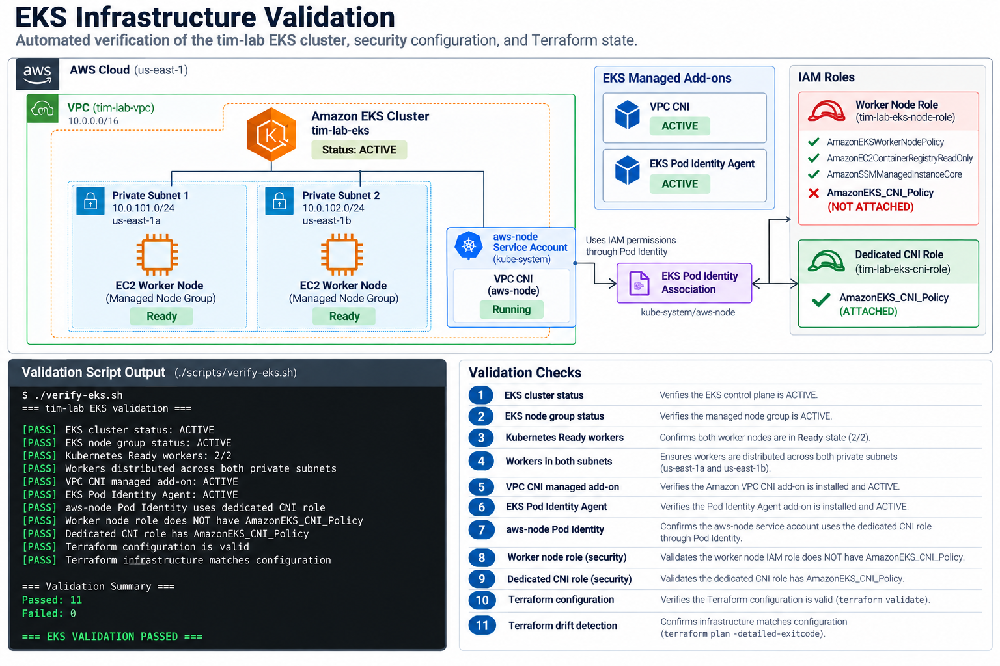

# Verification 02 — EKS Infrastructure

## Objective

Validate that the `tim-lab` Amazon EKS environment is healthy and that the cluster, worker nodes, networking components, IAM permissions, and Terraform configuration match the intended architecture.

This validation is automated using:

```text
scripts/verify-eks.sh
```

The script performs checks against AWS, Kubernetes, IAM, and Terraform and returns a non-zero exit code if any validation fails.

---

## Architecture



The `tim-lab-eks` cluster uses an EKS managed node group with worker nodes running across both private subnets.

The Amazon VPC CNI provides Kubernetes pod networking. Rather than granting the VPC CNI permissions through the general EC2 worker-node IAM role, the `aws-node` workload obtains its AWS permissions through EKS Pod Identity and a dedicated IAM role.

This separates Kubernetes networking permissions from the general worker-node permissions and follows the principle of least privilege.

### CNI IAM Flow

```text
kube-system/aws-node
        |
        v
EKS Pod Identity Agent
        |
        v
EKS Pod Identity Association
        |
        v
tim-lab-eks-cni-role
        |
        v
AmazonEKS_CNI_Policy
```

The EC2 worker-node IAM role does **not** have `AmazonEKS_CNI_Policy` attached.

---

## Automated Validation

The EKS environment can be validated by running:

```bash
./scripts/verify-eks.sh
```

The script performs the following checks:

1. EKS control plane is `ACTIVE`.
2. EKS managed node group is `ACTIVE`.
3. Two Kubernetes worker nodes are `Ready`.
4. Worker nodes are distributed across both private subnets.
5. Amazon VPC CNI managed add-on is `ACTIVE`.
6. EKS Pod Identity Agent is `ACTIVE`.
7. The `aws-node` service account uses the dedicated CNI IAM role through EKS Pod Identity.
8. The worker-node IAM role does **not** have `AmazonEKS_CNI_Policy`.
9. The dedicated CNI IAM role **does** have `AmazonEKS_CNI_Policy`.
10. Terraform configuration passes `terraform validate`.
11. Terraform reports that the deployed infrastructure matches the Terraform configuration.

---

## Successful Validation

Example of a successful validation run:

```text
=== tim-lab EKS validation ===

[PASS] EKS cluster status: ACTIVE
[PASS] EKS node group status: ACTIVE
[PASS] Kubernetes Ready workers: 2/2
[PASS] Workers distributed across both private subnets
[PASS] VPC CNI managed add-on: ACTIVE
[PASS] EKS Pod Identity Agent: ACTIVE
[PASS] aws-node Pod Identity uses dedicated CNI role
[PASS] Worker node role does NOT have AmazonEKS_CNI_Policy
[PASS] Dedicated CNI role has AmazonEKS_CNI_Policy
[PASS] Terraform configuration is valid
[PASS] Terraform infrastructure matches configuration

=== Validation Summary ===
Passed: 11
Failed: 0

=== EKS VALIDATION PASSED ===
```

---

## EKS Control Plane and Managed Nodes

The validation first confirms that AWS reports the EKS control plane as `ACTIVE`.

It then independently verifies that the EKS managed node group is `ACTIVE`.

These checks validate the AWS-managed portions of the Kubernetes environment before checking Kubernetes itself.

The script then queries Kubernetes and confirms that both expected worker nodes are in the `Ready` state.

This distinction is important because an EKS node group can exist at the AWS infrastructure layer while the Kubernetes nodes themselves may still have configuration, networking, or registration problems.

The worker nodes are also checked to confirm that they are distributed across both private subnets.

This verifies that the running EC2 workers match the intended multi-AZ architecture rather than simply confirming that the subnet configuration exists in Terraform.

---

## VPC CNI Validation

Amazon VPC CNI provides VPC-native networking for Kubernetes pods running in the EKS cluster.

The VPC CNI is configured as an EKS managed add-on.

The validation script confirms that AWS reports the add-on as:

```text
ACTIVE
```

This confirms that the managed networking component required for assigning VPC addresses to Kubernetes pods is installed and healthy from the EKS perspective.

Functional pod networking is validated separately in the Kubernetes verification stage.

---

## EKS Pod Identity

EKS Pod Identity is used to provide AWS permissions directly to Kubernetes workloads without requiring those permissions to be inherited from the EC2 worker-node IAM role.

The EKS Pod Identity Agent runs on the worker nodes and provides the mechanism through which workloads can obtain credentials for their assigned IAM roles.

The validation confirms that the EKS Pod Identity Agent managed add-on is:

```text
ACTIVE
```

It also confirms that the `aws-node` service account in the `kube-system` namespace has an EKS Pod Identity association using:

```text
tim-lab-eks-cni-role
```

This establishes the relationship:

```text
aws-node
   |
   v
EKS Pod Identity
   |
   v
tim-lab-eks-cni-role
```

---

## CNI IAM Security Validation

A key objective of this configuration is preventing VPC CNI permissions from being unnecessarily granted to every workload running on an EKS worker node.

Initially, `AmazonEKS_CNI_Policy` was attached directly to:

```text
tim-lab-eks-node-role
```

That configuration was functional, but it placed the VPC CNI permissions on the general EC2 worker-node IAM role.

The configuration was hardened by:

1. Installing the EKS Pod Identity Agent.
2. Creating the dedicated `tim-lab-eks-cni-role`.
3. Attaching `AmazonEKS_CNI_Policy` to the dedicated CNI role.
4. Creating a Pod Identity association for `kube-system/aws-node`.
5. Removing `AmazonEKS_CNI_Policy` from the EC2 worker-node IAM role.
6. Managing the VPC CNI as an EKS managed add-on.
7. Importing the existing VPC CNI add-on into Terraform management.

The validation script verifies both sides of this configuration.

The worker-node role must **not** contain:

```text
AmazonEKS_CNI_Policy
```

while the dedicated CNI role must contain:

```text
AmazonEKS_CNI_Policy
```

The expected IAM separation is therefore:

```text
tim-lab-eks-node-role
├── AmazonEKSWorkerNodePolicy
├── AmazonEC2ContainerRegistryPullOnly
└── AmazonEKS_CNI_Policy                 NOT ATTACHED


kube-system/aws-node
        |
        v
EKS Pod Identity
        |
        v
tim-lab-eks-cni-role
        |
        └── AmazonEKS_CNI_Policy         ATTACHED
```

This provides a more tightly scoped IAM architecture for the VPC CNI.

---

## Terraform Validation

The final portion of the script verifies the Infrastructure as Code configuration.

First:

```text
terraform validate
```

confirms that the Terraform configuration is syntactically valid and internally consistent.

The script then runs Terraform using:

```text
terraform plan -detailed-exitcode
```

Terraform uses the following exit codes:

```text
0 = No infrastructure changes detected
1 = Terraform error
2 = Infrastructure changes detected
```

A successful validation requires an exit code of `0`.

This confirms that the infrastructure currently deployed in AWS matches the Terraform configuration tracked in the repository.

---

## Validation Result

The completed validation produced:

```text
Passed: 11
Failed: 0
```

Result:

```text
EKS VALIDATION PASSED
```

The validation confirms that:

- The EKS control plane is healthy.
- The managed node group is healthy.
- Both Kubernetes workers are Ready.
- Workers are distributed across both private subnets.
- The VPC CNI managed add-on is active.
- The EKS Pod Identity Agent is active.
- `aws-node` is associated with the dedicated CNI IAM role.
- VPC CNI permissions have been removed from the worker-node role.
- VPC CNI permissions are attached to the dedicated CNI role.
- Terraform configuration is valid.
- Terraform reports no pending infrastructure changes.


